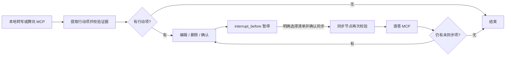

# MeetMind 会议行动助手

原始转写 → 带证据的行动项 → 人工编辑与确认 → 滴答清单。

支持单 Agent 提取及可选的双 Agent 核验与一次修正，默认使用单 Agent。双 Agent 配置见 [使用说明](docs/双Agent使用说明.md)，小样本评估结果见 [开发集对照](evaluation/runs/dual-agent-v2/COMPARISON.md) 和 [保留集报告](evaluation/runs/dual-agent-v2/HELDOUT.md)。

## 启动与依赖

依赖由 **uv** 管理，只安装在本项目 `.venv`，没有改动系统 Python 或 conda。Python 要求 ≥3.10；已有的 Python 3.10 可用。`uv.lock` 锁定已验证版本。

```sh
uv sync --locked
cp -n .env.example .env
.venv/bin/python -m meetmind.server
```

打开 http://127.0.0.1:8765 。端口可通过 `PORT` 修改。点击「导入会议」，选择最近 1 / 3 / 7 天，查询并选择会议，再点击「导入并分析」。腾讯会议方式不要求输入 MCP 参数或会议主题；已导入会议直接打开。手动导入标签页保留主题、日期、粘贴原始转写、上传 TXT / JSON（最大 2 MB）和填入示例，导入后手动启动分析。无云录制的会议标为不可导入。

## 技术栈与流程

| 层级 | 实现 |
| --- | --- |
| 编排 | LangGraph StateGraph、条件路由、SQLite checkpoint |
| 人工确认 | `interrupt_before=['sync_tasks']`，逐项编辑/确认后显式恢复 |
| 输入 | 本地转写或腾讯 MCP `get_transcripts_details` 节点 |
| 提取 | 自有模型提取；无模型时离线规则演示 |
| 输出 | 滴答 MCP（默认，服务端负责官方 OAuth）；官方 API 为可选备选 |
| 观测 | 可选 LangSmith tracing，模型调用记录实际返回的 token usage |
| 网页/存储 | FastAPI + Uvicorn、原生 HTML/CSS/JS、SQLite |



图定义在 `meetmind/workflow.py`。每场会议 ID 对应一个 `thread_id`；checkpoint 在 `data/meetmind.sqlite3.checkpoints`，人工修改和同步结果仍以 `data/meetmind.sqlite3` 为准，避免恢复陈旧的确认内容。重启后可继续确认和同步。旧版本已生成的报告会在首次同步时建立 checkpoint，不重新提取或覆盖修改。

按需求采用静态 `interrupt_before`。当前 [LangGraph 官方文档](https://docs.langchain.com/oss/python/langgraph/interrupts#debugging-with-interrupts) 更推荐动态 `interrupt()` 实现人工确认；因此这里除了图暂停，还在恢复入口及写入节点重复检查人工确认和待办状态，禁止通过普通分析请求恢复写操作。

## 配置

首次启动前复制 `.env.example` 为 `.env`；已有 `.env` 时保留原配置。用编辑器在本地填写，重启服务后生效；已存在的 shell 环境变量优先。不要将真实凭据发到聊天或提交到仓库。

仓库保留源码、测试、依赖锁、文档和评估汇总报告；`.env`、虚拟环境、本地数据库与备份、私有评估输入和逐次运行产物均由 `.gitignore` 排除。运行时自动创建本地 `data/`。评估脚本需要自行准备输入，历史冻结集测试在缺少 `evaluation/data/frozen/v1/lock.json` 时跳过；恢复完整私有评估目录后会执行指纹及数据一致性检查。详见 [评估说明](evaluation/README.md)。

### 分析模型

- `LLM_BASE_URL`：兼容 Chat Completions 的服务地址，含 `/v1` 等 API 前缀，程序追加 `/chat/completions`。
- `LLM_API_KEY`：服务 API key，本地无认证模型可留空。
- `LLM_MODEL`：支持 `response_format: json_object` 的模型 ID。
- `LLM_PROVIDER`：可选 LangSmith provider 标识，默认 custom。

配置模型后，分析会将当前会议完整转写发送至指定服务。无模型时只做本地关键词提取，不推算「周五」等相对日期，不自动生成验收标准，界面标注为规则演示。

### 腾讯会议 MCP

参照 [官方文档](https://meeting.tencent.com/support/topic/2233/index.html)，填写 `TENCENT_MCP_URL`、`TENCENT_MEETING_TOKEN`、`TENCENT_SKILL_VERSION`，以官方 Skill 包 `config.json` 为准。`TENCENT_MCP_TRANSPORT=jsonrpc` 对应已验证的官方 v1.0.15 HTTP JSON-RPC 代理，也保留 `streamable_http` / `sse` 支持。

网页导入调用后端会议列表接口，自动处理列表分页、会议元数据和录制文件定位，再由 LangGraph 获取原始转写并分析。已适配官方网关 data/body 包装、minutes/paragraphs/sentences/words 结构和转写分页；保留发言人、时间、段落 ID，多录制以文件 ID 区分证据。周期会议仅在返回明确子会议标识时选择对应录制，无法确定时拒绝导入，避免混入其他场次。实际账号已验证会议查询，但最近会议没有云录制，真实转写仍待可用样本验收。严禁使用 get_smart_minutes 等摘要代替原文。

腾讯官方 Skill v1.0.15 已安装在 `~/.codex/skills/tencent-meeting-mcp`，下轮对话可用。项目启动时从 `.env` 加载 Token 为进程环境变量，不修改全局 shell 配置。

标准 MCP 传输使用 [官方 Python SDK](https://github.com/modelcontextprotocol/python-sdk)，支持协议初始化、工具发现分页和结构化结果。

### 滴答清单 MCP（首选）

官方 [MCP 连接说明](https://help.dida365.com/articles/7438132116019216384) 支持 Streamable HTTP、OAuth 和 Bearer Token。当前项目使用 Bearer Token，配置如下：

```dotenv
DIDA_BACKEND=mcp
DIDA_MCP_URL=https://mcp.dida365.com
DIDA_MCP_TRANSPORT=streamable_http
DIDA_MCP_AUTH=bearer
DIDA_MCP_BEARER_TOKEN=本地填写API口令
DIDA_MCP_PROJECTS_TOOL=list_projects
DIDA_MCP_CREATE_TOOL=create_task
DIDA_MCP_TASK_MAPPING={"task":"$payload"}
```

API 口令在网页版「头像 → 设置 → 账户与安全 → API 口令」创建。凭据通过 `Authorization: Bearer ...` 发送。兼容原先 `DIDA_MCP_API_KEY` 变量：bearer 模式下也按 Bearer 发送，无需迁移已填写的口令。`DIDA_ACCESS_TOKEN` 仅用于下面的 Open API 备选，与 MCP API 口令分开。项目尚未实现官方 MCP OAuth 浏览器授权流程。

已用官方远程服务验证工具发现成功（58 个工具），`create_task` 需要嵌套 task 对象。创建前按服务 schema 校验，不匹配时拒绝调用；任务中保留标题、清单、会议主题、负责人、验收标准和已填写的截止日期；不附加原文引用、转写时间戳或段落 ID。原文证据仅留在 MeetMind 中。清单响应需为 id/name 数组（可在 projects/data 内）；任务响应需有 id（可在 task/data 内）。创建任务仍需网页人工确认。

若连接社区 MCP，可显式设置 `DIDA_MCP_AUTH=api_key`，以 `x-api-key` 认证，工具名和参数以该服务的 schema 为准。也可设置 `DIDA_BACKEND=api`、`DIDA_ACCESS_TOKEN`，直接使用官方 `/open/v1/project`、`/open/v1/task`，token 过期需重新授权更新。

### 可选 LangSmith tracing

`LANGSMITH_TRACING=false` 默认关闭。主动启用时填写：

```dotenv
LANGSMITH_TRACING=true
LANGSMITH_API_KEY=本地填写
LANGSMITH_PROJECT=meetmind
```

启用后会发送节点和模型输入输出（**含转写**）到 LangSmith。图节点可查看延迟；自定义模型调用通过 `@traceable(run_type='llm')` 上报实际返回的 prompt/completion token 数，服务没有 usage 时不会编造。凭据在函数内部读取，不作为图状态或 trace 参数。参照 [LangSmith LLM tracing 文档](https://docs.langchain.com/langsmith/log-llm-trace)。没有真实 LangSmith 凭据，远端可观测性尚未联调。

## 转写格式

```text
[00:15] 小林：我负责提交接口文档。
[01:25] 主持人：需要跟进验收清单的整理。
```

或标准 JSON（可外包一层 `{"paragraphs": [...]}`）：

```json
[
  {"id": "p1", "timestamp": "00:15", "speaker": "小林", "text": "我负责提交接口文档。"}
]
```

纯文本也可导入，缺少的时间和发言人会标为未知。模型必须引用存在的段落 ID，原句始终来自本地保存的转写。引用有效不等于语义正确，仍需人工核实。

## 同步约束与首版边界

- 修改行动内容、议题、负责人、日期或验收标准后，确认失效，保存后需重新确认；只同步已确认且勾选的条目。
- 负责人、日期、验收标准允许留空，未知内容标记待确认。负责人写入任务描述，不等于滴答成员分派。
- 成功同步记录任务 ID 并锁定。工具 schema、字段映射等创建前检查失败时，未发送写入请求，条目保留待同步，可修正配置后重试；请求已发送后发生异常、超时或进程中断，则结果未知，锁定条目并要求到滴答核实，禁止自动重试。
- 本机单用户使用，监听 127.0.0.1。`project_id` 和行动状态已预留，不实现跨会议追踪、实时录音或自动分析。

## 验证

```sh
.venv/bin/python -m unittest discover -s tests -v
node --check static/app.js
```

41 项测试通过，覆盖原文和引用校验、未知字段、编辑确认失效、防重复写入、图暂停与重建后恢复、分批同步、空报告结束、旧报告迁移、MCP schema 与字段映射、实际 token 用量上报。外部写入全用 mock，不创建真实任务。腾讯官方 MCP 工具发现已实测成功（36 个远端工具）；滴答官方 MCP 工具发现和只读清单查询已验证；会议列表与无录制状态已实测，转写适配和分页已做模拟测试；真实转写、模型、滴答写入和 LangSmith 仍待联调。

## 前端交互（2026-11-01）

蓝白三栏布局：左侧会议导航、中间议题折叠与紧凑任务列表、右侧原文证据。任务默认收起编辑表单，点击行或箭头展开，同一时刻仅展开一项；未保存草稿在切换任务时保留。确认规则及修改后重新确认保持不变。原文定位使用浅蓝高亮；窄屏自动调整为上下布局。配置弹窗只显示连接状态，不再暴露工具 schema 或参数 JSON。

## 会议记录删除

侧边栏会议条目悬停或键盘聚焦时显示删除图标，触屏设备常显。二次确认后调用 `DELETE /api/meetings/:id`，清理该会议的本地转写、报告与 LangGraph 断点；不删除腾讯源会议或已同步的滴答任务。后台分析/同步进行中暂不允许删除。删除当前会议后自动切换到首个剩余会议，全部删除后显示“暂无会议”。

页面已移除装饰性英文、口号和空页面营销文案，保留业务标题、状态及必要操作提示。

## 滴答按议题分组同步

用户在网页确认同步后，在所选目标清单内部以议题名查找分组（官方 MCP column），同名分组复用，没有时创建，再将任务的 `columnId` 指向对应分组。不同清单的分组互不混用。不是创建多个清单，也不是清单文件夹（project group）。存在多个同名分组时拒绝任意选择，提示先整理同名分组。

使用默认嵌套映射 `DIDA_MCP_TASK_MAPPING={"task":"$payload"}` 即可；自定义字段映射还需保留 `columnId`。按议题分组功能需要官方 MCP 的 `list_columns` / `create_column` / `create_task`，Open API 备选模式目前不支持此流程，会明确拒绝，不降级写入未分组任务。分组创建或查询失败时不发送任务创建请求，可修正后再次确认同步；任务创建请求已发送但结果未知时，仍沿用禁止自动重试的保护。

原文证据在 MeetMind 内保留、展示及校验，不再附加到滴答任务描述。旧的已同步任务不自动修改或迁移。

## Web 后端结构

后端使用 FastAPI + Uvicorn，启动方式保持 `.venv/bin/python -m meetmind.server`。

- `meetmind/server.py`：显式路由、会议存储和业务流程调用，从 `analyze_meeting`、`review_action`、`sync_tasks` 开始阅读。
- `meetmind/schemas.py`：请求字段和类型校验，FastAPI 自动解析 JSON 并生成 OpenAPI schema。
- `meetmind/web.py`：通用 HTTP 配置，包括请求体大小限制、Host 校验、响应头和统一错误格式；学习业务时可以跳过。

启动后可打开 http://127.0.0.1:8765/docs 查看交互式接口文档。

接口路径和前端使用的 `{"error": "..."}` 错误格式保留。接口测试使用 FastAPI TestClient，不再启动标准库 HTTP 服务。应用启动时通过 lifespan 初始化数据库并恢复中断状态。

当前仍按本机单用户、单进程运行：会议数据没有用户归属，锁和腾讯候选缓存位于进程内。框架改造提供了路由与请求模型边界，但不代表已经支持多用户或多 worker；不要增加 Uvicorn worker 数。

## 腾讯转写发言人兼容（2026-11-03）

原始转写解析同时支持 MCP 实际返回的 `speaker.user_name`、REST 格式的 `speaker_info.username`，以及规范段落中的字符串 `speaker`。仅在没有可用姓名时显示“未知发言人”，不从对话称呼推测真实姓名。相关回归测试覆盖双人交替发言、缺失姓名和导入后的行动项负责人传递。

## 滴答同步限流与反馈（2026-11-03）

每批同步只发现一次工具 schema，在批次结束时丢弃缓存，减少分组查询、创建分组、创建任务前的重复 `tools/list` 请求。嵌套 MCP 限流错误显示为“服务端限流”；任务发送后的未知结果仍禁止自动重试。任务列表直接显示同步错误，折叠编辑区时也可见，完成提示区分已同步、未写入与待核实数量。“已确认”仅代表人工确认，不等于已写入滴答。

## 待核实任务的人工闭环

待核实条目直接展示所属议题分组和上次失败原因，并提供两个经确认弹窗提交的操作（`POST /api/resolve-uncertain`）：

- 确认已创建：`uncertain → synced`，记录人工核实时间、方式、结果及原错误；不编造远端任务 ID，之后禁止再次同步。
- 确认未创建，重新同步：`uncertain → pending`，清除当前错误，保留核实历史；仅恢复人工同步入口，仍需点击同步按钮才会发送创建请求。若原流程已结束，只重新设置人工确认断点，不运行节点。

工具调用新增一个保守分支：仅滴答的 MCP 协议错误（`McpError`，代码 `-32601` / `-32602`），且错误全文匹配明确的工具不存在/无效工具名格式并包含本次工具名时，识别为执行前拒绝。普通文本错误、业务 `isError`、超时、网络错误、5xx 和混合异常仍按原有未知结果处理。识别后先删除该 service 的批次缓存，再强制查询一次工具列表；无论刷新是否成功，都不自动重发创建请求，任务回到 pending。主同步循环会捕获错误后继续其他条目，所以必须在此处主动失效缓存。

同步界面增加 pending 汇总，列出标题、所属分组和上次失败原因。上述操作不包含自动核实、后台查询滴答或自动重试。
